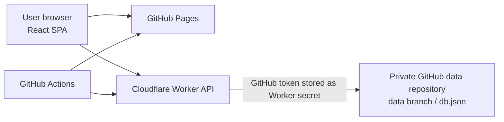

# iON CCTV Operations Workspace

> **Architecture briefing for Infrastructure, Security, and Deployment teams**
> This document describes the current demo, the proposed AWS production architecture, its security controls, and the work needed to migrate. The AWS design is a proposal; it is **not deployed or yet validated**.

## Executive summary

iON CCTV coordinates temporary CCTV installation work for exams across clients, zones, states, cities, and test-center (TC) venues. The application covers venue requirements, vendors, installation quotations, multi-stage approvals, work orders, installation completion declarations, post-exam observations, and operational/financial dashboards.

The current application is a React single-page app hosted on GitHub Pages. A Cloudflare Worker authenticates application users and reads/writes a JSON database in a private GitHub repository. The demo has no AWS resources.

### AWS recommendation

Host the static React application in a **private S3 bucket behind CloudFront**, not on EC2 or Lambda. Use:

- **Amazon Cognito User Pools** for user authentication and identity lifecycle, including administrator-managed user invitations/creation, sign-in, MFA, recovery, disablement, and password resets.
- **Amazon API Gateway REST API** and **AWS Lambda** for application APIs and server-side authorization.
- **Amazon DynamoDB** for structured operational records and audit events.
- **Private Amazon S3 buckets** for quotation PDFs, generated work orders, and controlled backups; issue short-lived presigned URLs for file transfer.
- **AWS IAM** execution and deployment roles with least privilege.
- **Amazon CloudWatch** logs with **30-day retention** for application/operational logs, alarms, and dashboards; **AWS CloudTrail** for AWS control-plane auditing.
- **GitHub Actions OIDC** to assume a restricted AWS deployment role without long-lived AWS keys.

This design separates identity, application records, documents, and deployment. It removes the current single-JSON-file write bottleneck and keeps PDF bytes out of application records.

## Current application (as-is)

### Current architecture



| Area | Current demo implementation |
|---|---|
| Web application | React + TypeScript SPA, built with Vite and hosted on GitHub Pages. |
| Authentication | Worker-managed app accounts, PBKDF2 password hashes, and an eight-hour signed session kept in browser session storage. Users do not provide GitHub credentials. |
| API and persistence | Cloudflare Worker reads/writes the complete `db.json` through the GitHub Contents API. A repository-scoped GitHub token is held as a Worker secret. |
| PDFs | Quotation PDFs are base64-embedded in `db.json`; work orders are generated in the browser and currently identify themselves as dummy operational work orders. |
| Save behavior | Changes are saved as application data snapshots. The database has a 16 MB configured limit; the browser now reports an over-limit save before sending it. |
| Roles and zones | The UI has role/page/action permission checks and zone-scoped views. The current general data API does **not** enforce every feature permission or zone boundary server-side. This is a demo limitation, not an acceptable production authorization boundary. |
| Operations | Worker Observability is disabled. Login events and last-login timestamps are not currently recorded. Existing sign-in audit entries are historical. |
| AWS | No Cognito, DynamoDB, S3, Lambda, CloudWatch, or AWS IAM deployment exists today. |

The current design is useful for a demo, but the full-database GitHub write model has size, concurrency, and operational limits. Do not treat the current application as production-secure for confidential, personal, or regulated data.

> **Historical data exposure:** The private data repository previously had a public `data` branch. Removing a branch cannot remove copies, forks, clones, or all historical Git objects. Treat data stored there as potentially exposed; rotate any credentials that may have been present and have Security review the repository history before migration. Gemini/AI chat is not enabled in the current demo.

## Website capabilities

### Dashboards and reporting

- **Executive dashboard:** summary KPIs, client/exam comparisons, and drill-down into venue details.
- **Financial dashboard:** installation cost summaries and financial comparisons.
- **Operations dashboard:** required/completed/pending venues, completion percentage, quotation availability, work-order downloads, temporary CCTV installation status, and equipment-provision metrics (proxy, internet, and storage).
- **Vendor dashboard:** vendor-level venue, candidate, cost, and per-candidate comparisons.
- **Venue dashboard:** venue cost and camera analysis, temporary CCTV days, top venues, and zone performance.
- Dashboards and data pages support relevant client, exam, date, zone, state, city, and TC-code filtering.
- Tables are searchable, sortable, paginated, and can be exported to Excel or PDF where provided.

### Venue requirements and vendor management

- Maintain venue requirements with client, exam, zone, state, city, TC code/name, exam dates, and scheduled candidate counts.
- Import requirements from spreadsheet templates with preview, new/update/error counts, and validation before applying changes.
- Maintain vendor records and zone association; import vendors with a preview and error report.
- Filter, search, update, and (where permitted) remove records.

### Installation records and quotations

- Create and edit Full Vendor or Partial Vendor installation quotations against a requirement/venue.
- Capture vendor, camera count, proxy/internet availability, storage availability, storage type/quantity/size, local vendor cost, minimum cost, remarks, and supporting quotation PDF.
- Maintain exam-date and candidate schedules, quote revisions, and venue cost history.
- Bulk-upload installation records from a template with preview, validation, duplicate handling, new/update/error counts, and an error spreadsheet.
- Filter records by client, exam, zone, state, city, TC code, date range, and approval status.
- Records show approval status, quotation, observation count, and related details.

### Approvals

- Two approval stages: **Surveillance Head** followed by **Head of Enablement**.
- Approvers can approve or return a quotation with remarks; approval history is retained.
- Higher-than-previous-cost quotations require the configured exception/remarks workflow.
- Support bulk approval with a summary of approved, skipped, and exception records.
- Approval dashboards provide pending/approved/returned drill-downs, candidate and cost details, quote history, and vendor context.
- Approval and quotation alert lead times are configurable by a Super Admin. These are in-app criteria; they are not email/SMS notifications.

### Work orders and temporary CCTV installation

- Generate individual or bulk work-order PDFs from approved installation records.
- The current work-order PDF is explicitly a dummy operational document, not a finalized legal/contractual template.
- Record who downloaded each work order and when; work orders can be filtered by client, exam, zone, state, and download status.
- The temporary CCTV status page lists venues whose work order has been downloaded.
- Authorized zonal users can confirm installation for one or multiple venues, provide the installation date, and accept the installation declaration.
- Operations dashboards show work-order and temporary CCTV completion counts.

### Post-exam observations

- Backend users can add an observation against a venue and exam date.
- Filters include client, exam, zone, state, exam date, and venue/TC code.
- Observations are associated with normalized TC code so an observation can appear across projects for that TC code.
- Records and Approvals show observation counts and contextual detail, including exam and vendor information; the latest two comments are presented with pagination/history.

### Users, access, and administration

- Built-in roles include Super Admin, Sub Admin, User, Viewer, Zonal User, Backend User, Surveillance Head, and Head of Enablement; custom roles are supported.
- Super Admins can manage users, access roles, groups, and approval alert criteria.
- Groups can carry permissions and zone assignments; user and group zone scopes affect the workspace view.
- Users can download an accessible-data JSON backup; restore is restricted to administrators.
- Entity changes and exports are recorded in the application audit log. New sign-ins are not currently written to that log.

## Proposed AWS architecture (to-be)

### Logical architecture

```mermaid
flowchart LR
  User[User browser] --> DNS[Route 53<br/>custom app and API domains]
  DNS --> CF[CloudFront + AWS WAF<br/>HTTPS, caching, edge protection]
  CF -->|Static SPA files, Origin Access Control| Web[S3 private web bucket]
  User -->|JWT-authenticated API requests| APIGW[API Gateway REST API<br/>throttling, request validation, access logs]
  APIGW -->|JWT validation| Cognito[Cognito User Pool<br/>user management, MFA, sign-in, recovery]
  APIGW --> Lambda[Application Lambda APIs]
  Lambda --> AuthZ[Server-side role and zone authorization]
  AuthZ --> DDB[(DynamoDB<br/>operational entities and audit events)]
  Lambda -->|Create short-lived, scoped URL| User
  User -->|Presigned upload/download| Docs[S3 private document bucket(s)<br/>quotations, work orders, backups]
  Docs -->|Object event / scan request| Scan[Optional malware-scanning workflow]
  Lambda --> CW[CloudWatch Logs, Metrics, Alarms]
  APIGW --> CW
  Trail[CloudTrail] --> Audit[Restricted audit archive]
  GH[GitHub source repository] --> GHA[Option A: GitHub Actions]
  GHA -->|OIDC / AssumeRole| DeployRole[Restricted deployment role]
  GH -->|GitHub connection| CP[Option B: AWS CodePipeline + CodeBuild]
  CP -->|AssumeRole| PipelineRole[Restricted pipeline role]
  DeployRole --> CF
  DeployRole --> Web
  DeployRole --> APIGW
  DeployRole --> Lambda
  DeployRole --> DDB
  PipelineRole --> CF
  PipelineRole --> Web
  PipelineRole --> APIGW
  PipelineRole --> Lambda
  PipelineRole --> DDB
```

**Request path:** CloudFront serves the SPA from an S3 origin protected by Origin Access Control. The browser calls the API Gateway REST API over HTTPS. API Gateway validates Cognito JWTs; Lambda then performs application-level role, group, and zone checks before accessing DynamoDB or issuing a document URL. The browser receives no AWS credentials and no direct DynamoDB access.

### AWS component responsibilities

| Component | Proposed responsibility and boundary |
|---|---|
| Route 53 | Optional DNS for the app/API domains and health-based routing if required. |
| CloudFront | Serve versioned static assets globally over HTTPS; cache immutable assets and apply a controlled SPA fallback. |
| AWS WAF | Attach web ACLs to CloudFront and the API entry point. Add managed protections, rate-based rules, and carefully tuned allow/deny rules. |
| S3 web bucket | Store only built frontend assets. Block public access; allow reads only through CloudFront OAC. Enable versioning as required for rollback. |
| Cognito User Pool | Own user identity and authentication: administrator-managed invitations/creation, sign-in, MFA, password policy/recovery, disablement, and optionally enterprise federation. Store application roles/zone scope in controlled app-profile data and/or approved Cognito claims. |
| API Gateway REST API | HTTPS API entry, Cognito authorizer, request validation, throttling/quotas, CORS, and structured access logs. Do not put sensitive data in URLs. |
| AWS Lambda | Implement APIs for requirements, vendors, records, approvals, work orders, installation status, observations, exports, user administration, and presigned URL issuance. Keep functions small and use separate execution roles by trust boundary. |
| DynamoDB | Store structured entities and status/history records, not PDF bytes. Use conditional writes/version fields to prevent silent lost updates. Use transactions where a business action must update multiple related items atomically. |
| S3 document bucket(s) | Store quotation PDFs, approved/generated work orders, and restricted backups. Use private buckets, Block Public Access, encryption, versioning/retention policies, and opaque object keys. |
| CloudWatch | Store application/API/Lambda operational logs for 30 days, dashboards, metrics, and alarms. Configure retention explicitly in infrastructure as code. |
| CloudTrail | Record AWS API/control-plane activity and administrative changes. Set its archive and retention separately from 30-day application logs. |
| GitHub Actions + IAM OIDC **or** CodePipeline/CodeBuild | Two deployment choices while keeping GitHub as the source repository. In either choice, use restricted short-lived IAM roles; no long-lived AWS access key in GitHub secrets or source code. |
| SQS + worker Lambda (optional) | Process large imports, bulk work-order generation, PDF scanning, or other work that should not hold an API request open. Add when measured workload requires it. |

### Why S3 + CloudFront for the website (not Lambda or EC2)

The current frontend is a static React SPA after build. S3 + CloudFront is therefore the simplest fit: it avoids managing servers, supports edge caching, provides high availability, and keeps API compute separate. Lambda is recommended for the **API and background jobs**, not for serving static files. EC2 is only justified if a confirmed requirement needs a continuously running server, OS-level control, or software that cannot run in managed/serverless services. AWS Amplify Hosting is a possible managed alternative, but S3 + CloudFront gives the infrastructure team direct control over origin access, WAF, caching, and deployment.

### Build-time npm vs website runtime

The project needs Node.js/npm **to build and develop**, not to serve the published website:

1. A developer or CI runner installs dependencies (`npm ci`) and runs checks/build (`npm test`, `npm run type-check`, `npm run lint`, `npm run build`).
2. Vite produces static HTML, CSS, JavaScript, and assets in `dist/`.
3. CI uploads the contents of `dist/` to the private web S3 bucket; CloudFront serves those files to browsers.
4. End users do not install npm or Node.js. S3 does not execute React/TypeScript or run `npm`; the browser runs the compiled JavaScript.
5. Lambda is deployed separately with its own runtime and packaged backend dependencies. It runs API requests and short background tasks, not the SPA.

This works because the current website is a client-side React SPA. If server-side rendering or a Node server is introduced later, the hosting design must be revisited.

### Is Lambda sufficient for the application?

Lambda is a good fit for the application's normal API work: validate requests, enforce roles/zones, read/write DynamoDB records, create presigned S3 URLs, and perform short exports or business operations. Keep PDFs and large uploads out of API request bodies; transfer them directly between the browser and S3. Put large imports, bulk PDF generation, and scanning into SQS-backed asynchronous jobs with status reporting.

Lambda is not an unlimited always-on server. Design around its execution timeout, payload, memory, concurrency, and cold-start behavior. Very long-running work, persistent connections, unsupported native dependencies, or OS-level requirements may need a container/EC2 service or a different managed service. No such requirement is currently established for the demo's core workflows.

## Data and document design

### DynamoDB logical entities

Keep the current business entities as structured, independently addressable records:

- Requirement/venue master and exam schedules.
- Vendor master.
- Installation/quotation records and current approval state.
- Quote revisions, approval decisions, and blanket approvals.
- Temporary CCTV installation date, declaration, and actor metadata.
- Post-exam observations.
- Application user profile, role/group assignment, and zone scope (identity/password remains with Cognito).
- Approval alert criteria and append-only application audit events.

The data team should choose **single-table or multiple-table design** only after documenting access patterns and expected volume. Define keys and GSIs for the actual filters: client, exam, exam date, zone, state, city, TC code, vendor, approval status, work-order status, and installation status. Use pagination for list APIs. Avoid table scans for normal dashboard queries; create/materialize summary views if measured dashboard traffic requires them.

### PDF and file lifecycle

1. The signed-in browser asks an authorized API endpoint to start an upload.
2. Lambda checks the user's permission, zone, target record, filename/type, and size policy; it creates an opaque object key and a short-lived presigned upload URL.
3. The browser uploads directly to a private S3 bucket. The API records metadata and upload state in DynamoDB; it does not store base64 file contents.
4. Validate checksum, file type/signature, and malware-scan status before making a file available. Use a quarantine prefix/bucket if scanning is required.
5. To view/download, the browser requests an authorized short-lived presigned GET URL. Lambda verifies access to that specific record and object before issuing it.
6. Never log presigned URLs, PDF contents, credentials, or unnecessary personal data. Use short expirations and opaque object keys; do not make buckets public.

Use separate prefixes or buckets for `quotations/`, `workorders/`, and `backups/` according to access and retention needs. A browser-generated report can remain a user download; only retain files in S3 when the business needs a durable copy.

### Record consistency and audit history

- Store each record/revision/event separately rather than rewriting the entire application dataset.
- Add a version number and conditional update to records that users may edit concurrently.
- Use DynamoDB transactions for critical multi-record actions where partial success is not acceptable (for example, an approval decision plus its audit event).
- Keep application audit events append-only with actor, action, entity, timestamp, and bounded before/after metadata. Do not place PDFs or secrets in audit events.
- Choose audit retention with Security/Compliance. CloudWatch's 30-day operational-log retention is not the application audit-retention policy.

## Identity, authorization, and security controls

### Authentication

- Cognito User Pool is the identity provider; use the application client appropriate for a browser SPA (authorization code flow with PKCE where hosted OAuth is used).
- Use Cognito for user lifecycle management as well as sign-in: the Super Admin UI calls a protected backend endpoint to invite/create, disable, enable, and initiate password-reset operations. The Lambda uses narrowly scoped Cognito administrative permissions; the browser never calls Cognito admin APIs or receives AWS credentials directly.
- Keep the Cognito `sub` as the stable identity key in the application profile. Store business profile fields (display name, role assignment, groups, zone scope, active status, and audit metadata) in the app's controlled data store. Define how Cognito user changes and profile updates remain consistent, including failure/rollback behavior.
- Require MFA for administrators and decide whether MFA is required for all users; configure password policy, recovery, lockout/risk controls, and session/token lifetimes.
- Use Cognito groups or approved custom claims only for coarse roles. Keep user-specific zone/group assignments in an application profile when needed.
- Do not migrate current PBKDF2 password hashes into DynamoDB or expose them to the browser. Choose either a time-limited, security-reviewed Cognito migration trigger that verifies users against the legacy authentication service, or an invitation/password-reset cutover.

### Authorization (must be server-side)

- API Gateway validates token signature, issuer, audience/client, and expiry.
- Every Lambda endpoint checks the user's action permission and record scope. Client-side route hiding is UX only; it is not authorization.
- Enforce zone-level access **before** reading/writing a record or issuing an S3 URL. Apply group/zone rules to every list, detail, bulk, export, and document operation.
- Separate administrative actions (user/role changes, bulk imports, approvals, backups) from normal user operations.
- Protect approval transitions in the API: correct stage, actor role, current record version, required remarks, and any cost exception.
- Add server-side audit records for access changes, approvals, file uploads/downloads, bulk actions, exports, and security events.

### IAM and data protection

- Use distinct Lambda execution roles per service/function group. Grant only the DynamoDB actions and table/index ARNs required; scope S3 access to required buckets/prefixes and operations.
- Avoid wildcard `Action`/`Resource` policies except where AWS requires and where separately reviewed. Do not grant the browser an IAM role for data access.
- Use a separate deployment role trusted only by the expected GitHub repository, branch/environment, and GitHub OIDC audience. Scope its permissions to deployment resources.
- Encrypt DynamoDB, S3, and backups at rest with AWS-managed or customer-managed KMS keys according to Security policy; use TLS in transit.
- Enable S3 Block Public Access, bucket-owner-enforced object ownership, restrictive bucket policies, and access logging/data events appropriate to the data classification.
- Use Secrets Manager/Parameter Store only for secrets that are actually required. Cognito and IAM roles should replace static database/GitHub credentials.
- Add WAF protections, API throttles, input validation, upload size/type checks, dependency and secret scanning, and security testing before production.
- Keep PII, tokens, passwords, PDF contents, and presigned URLs out of CloudWatch logs. Redact/limit request bodies and use correlation IDs.

## Logging, monitoring, retention, and recovery

### CloudWatch (requested 30-day retention)

Set `retentionInDays: 30` explicitly for application Lambda log groups and API access logs. Monitor:

- API 4xx/5xx rates, latency (including p95), throttling, and authorizer failures.
- Lambda errors, timeouts, throttles, concurrency, and duration.
- DynamoDB throttles, errors, consumed capacity, and latency.
- S3 request errors, upload/scan failures, and unusual access-denied patterns.
- Cognito sign-in failures, WAF blocks/rate limits, and bulk-job failures.

Create dashboards and actionable alarms. Send alarms to an agreed notification channel (for example, SNS email or the team's incident platform). Define thresholds and owners during implementation; do not page on uncalibrated demo thresholds.

### Cost drivers and sizing

No AWS cost estimate is included because request volume, file sizes, region, retention, and availability targets have not been supplied. Build the estimate with the AWS Pricing Calculator after the teams agree on those inputs. Main cost drivers are CloudFront data transfer/requests, WAF requests/rules, API Gateway calls, Lambda duration/concurrency, DynamoDB reads/writes/storage/PITR, S3 storage/requests/transfer, Cognito monthly active users, CloudWatch ingestion/retention, KMS, CloudTrail data events, and optional SQS/scanning workflows. On-demand DynamoDB capacity is a reasonable starting point when traffic is unknown; review measured usage before choosing a long-term capacity mode.

### Backups and recovery

- Enable DynamoDB point-in-time recovery and scheduled backups according to the agreed RPO/RTO.
- Enable S3 versioning and lifecycle/retention rules for documents and backups.
- Use CloudTrail for AWS administration/API activity; protect its archive from application-role modification.
- Test restore and rollback procedures, not only backup creation.
- Decide whether a second AWS region is needed after defining residency, RPO/RTO, cost, and operational ownership. Multi-region is not included in the initial proposal by default.

## Deployment and environment strategy

1. Provision AWS resources through reviewed infrastructure as code (AWS CDK or Terraform; the team should select one).
2. Create isolated Development, Test/UAT, and Production environments/accounts with separate data, Cognito pools, KMS keys, and deployment roles.
3. Keep application and infrastructure code in GitHub. Select one of the following deployment paths:
   - **Option A — GitHub Actions to AWS (recommended):** GitHub Actions builds/tests and deploys. GitHub OIDC exchanges the workflow identity for short-lived credentials by assuming a branch/environment-scoped AWS IAM role. This is the simplest fit when the team already uses GitHub Actions.
   - **Option B — AWS CodePipeline/CodeBuild from GitHub:** GitHub remains the source of truth; an AWS CodeConnections/GitHub connection triggers CodePipeline, CodeBuild runs checks/builds, and pipeline stages deploy through restricted AWS roles. This suits teams that require deployment approvals, artifacts, and execution visibility to be managed primarily in AWS.
   - Both paths can deploy the same frontend assets, Lambda packages, and IaC. Choose one release path per environment to avoid conflicting deployments. Do not use manual console uploads as the normal production process.
4. In either path, run tests/type-check/lint/security scans before promotion and do not store long-lived AWS credentials in GitHub or source code.
5. Deploy Lambda versions behind aliases and use a controlled promotion/rollback strategy. Deploy hashed frontend assets to S3 and invalidate only changed CloudFront paths when needed.
6. Use backward-compatible DynamoDB/application changes. Run data migrations as explicit, observable, restartable jobs with checkpoints and rollback plans.
7. Require an approval gate for Production and retain build/deployment metadata (commit SHA, artifact digest, environment, actor, and timestamp).
8. Keep configuration non-secret and environment-specific. Store secrets in AWS-managed secret storage only when required; do not put production values in the repository.

## Migration plan from the demo

1. **Inventory and freeze:** identify the approved source `db.json` commit, record entity counts, stop writes during final cutover, and create a restricted encrypted backup.
2. **Provision and test:** deploy Cognito, API Gateway, Lambda, DynamoDB, S3, CloudFront/WAF, logs, alarms, and IAM using IaC in non-production first.
3. **Transform records:** map requirements, vendors, installations, schedules, revisions, approvals, observations, access roles/groups, and audit history into the target schema. Preserve stable application IDs and timestamps.
4. **Extract documents:** decode quotation `dataUrl` content into PDF objects in private S3; validate PDF signatures, file counts, sizes, and checksums. Retain the current dummy work-order behavior only until the approved production template is signed off.
5. **Migrate identities:** preserve account identifiers/profile assignments where possible. Security chooses the Cognito migration-trigger approach or a forced password-reset/invitation flow; do not copy password hashes into application tables.
6. **Reconcile:** compare entity counts and relationships, validate file checksums and statuses, and run representative filters, dashboard totals, bulk updates, approvals, and exports in UAT.
7. **Cut over:** freeze source writes, run the final delta, verify sign-in and authorization, switch the production DNS/CloudFront/API configuration, and monitor alarms.
8. **Rollback/closeout:** keep a time-bounded read-only source snapshot and documented rollback decision point. After sign-off, remove legacy tokens and access paths, then apply approved retention/deletion policy.

## Benefits of the proposed design

| Current concern | AWS design benefit |
|---|---|
| One full JSON file is read and rewritten for many changes | DynamoDB stores independent records; conditional writes reduce conflicts and avoid whole-database rewrites. |
| PDF base64 increases database size and API payloads | S3 stores file bytes; DynamoDB stores only document metadata and object references. |
| Custom login logic and account secrets in a Worker | Cognito provides managed identity, MFA, recovery, and lifecycle; Lambda receives validated identity claims. |
| Zone/role filters are not enforced by the current general data API | Lambda enforces authorization before every read/write/export/presigned URL. |
| Public demo hosting and split providers | AWS-controlled domains, WAF, CloudFront, Cognito, API, data, and monitoring under reviewed IAM boundaries. |
| Limited operational visibility | CloudWatch metrics/logs/alarms and CloudTrail provide operational and administrative visibility with explicit retention. |
| Deployment depends on static provider credentials | GitHub OIDC assumes short-lived, branch/environment-scoped IAM roles. |
| Bulk work may hold up interactive requests | Optional queues/workers isolate heavy imports, scanning, and batch PDF generation. |

## Decisions required from the teams

### Infrastructure

- AWS organization/account ownership, primary region, DNS/domain, CloudFront/WAF policy, network requirements, and budget alarms.
- Whether accounts are separated by AWS account, organizational unit, or environment, and who owns on-call/incident response.
- Expected user count, venues/exams per year, peak bulk sizes, PDF sizes, and dashboard concurrency.
- RPO/RTO, backup retention, regional recovery expectations, and data residency.

### Security and compliance

- Data classification and whether venue/vendor/personnel data is regulated or confidential.
- MFA policy, enterprise federation/SSO, Cognito migration option, password reset communication, and admin approval process.
- Exact role-to-permission matrix and zone/group authorization rules; server-side tests for every endpoint.
- KMS key ownership/rotation, log/audit retention, malware scanning, S3 retention/deletion, and incident response.
- Threat model and security review of exports, backups, presigned URLs, bulk actions, and approval bypass attempts.

### Deployment and application teams

- AWS CDK vs Terraform, repository/environment protection rules, OIDC trust policy, release approval gates, and rollback owner.
- DynamoDB single-table vs multi-table layout, access patterns/indexes, optimistic concurrency, and audit event model.
- API contract, pagination/filter semantics, upload size policy, presigned URL expiry, and work-order generation/template ownership.
- Migration test plan, reconciliation evidence, cutover window, legacy read-only window, and final decommission date.

### Business/product owners

- Final work-order template, required legal text/signatures, retention duration, and whether downloaded files are immutable/versioned.
- Final installation declaration wording, who can submit/approve it, and correction/reversal process.
- Whether observation visibility across projects by TC code remains the desired rule.
- Notification requirements (current approval lead times are in-app only) and reporting/export requirements.

## Suggested presentation outline

1. Business problem and users served.
2. Current application capabilities and workflow.
3. Current demo architecture and limitations.
4. Proposed AWS architecture and static SPA hosting.
5. npm build-time requirements, runtime behavior, and serverless fit.
6. Cognito authentication/user management and server-side authorization.
7. DynamoDB data model and query/access patterns.
8. S3 PDF upload/download and presigned URL lifecycle.
9. IAM, encryption, WAF, and security boundaries.
10. CloudWatch 30-day logs, alarms, CloudTrail, backups, and recovery.
11. GitHub Actions OIDC vs AWS CodePipeline deployment options.
12. Migration, reconciliation, cutover, and rollback.
13. Decisions, risks, owners, and next steps.

## Local development (current demo)

```powershell
npm ci
$env:VITE_API_ENDPOINT = "https://<worker-name>.<account-subdomain>.workers.dev"
npm run dev
```

The current GitHub Actions workflows publish the demo to GitHub Pages and deploy its Cloudflare Worker. Required current-demo secrets and variables are maintained in repository settings, not in source code. For AWS, npm remains a build/CI requirement only; production browsers download the built `dist/` assets from CloudFront/S3.

## Source references

- [Application routes](./src/App.tsx)
- [Navigation and export/backup controls](./src/components/layout/Layout.tsx)
- [Application entities](./src/types/index.ts)
- [Role and permission definitions](./src/utils/permissions.ts)
- [Current Worker API](./worker/src/data-api.js)
- [Current Worker configuration](./worker/wrangler.toml)
